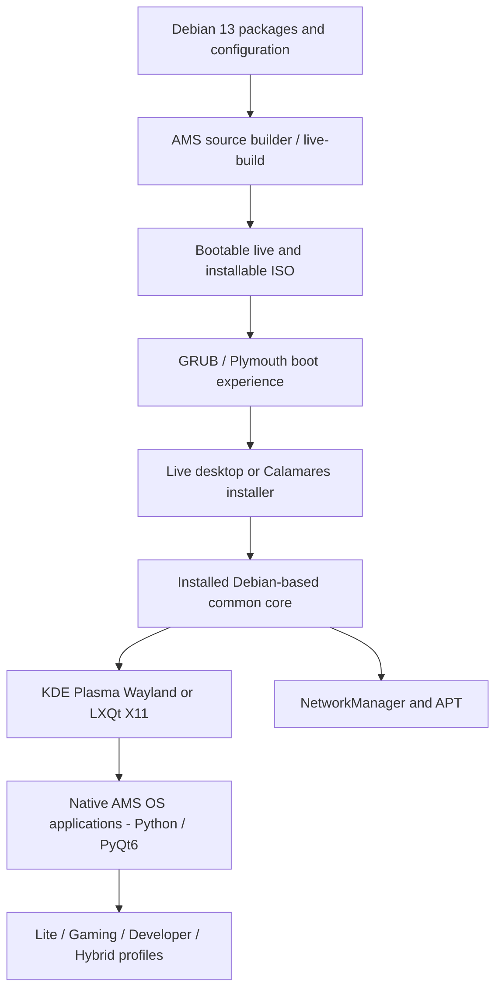

# AMS OS

**Debian 13-based Linux desktop project | Development preview**

**Documentation language:** [English](README.md) · [Ελληνικά](README_GR.md)

AMS OS is an independently developed Linux distribution prototype built on the Debian 13 (Trixie) ecosystem. Its goal is a recognizable, approachable desktop with a consistent AMS application layer, Greek/English localization and a shared Linux base serving several use cases.

> **Project status:** Development preview. Not a production-ready distribution or a validated release for arbitrary hardware. Images used in the promotional video include *conceptual reconstructions* and must not be confused with unedited runtime screenshots.

## Watch AMS OS in action

https://github.com/user-attachments/assets/f5e86d23-2e1c-443e-83b7-086aa3e1608d


A short walkthrough of the boot experience, Welcome screen, keyboard selection, installation summary, AMS OS applications, system settings, edition profiles and KDE Plasma desktop.

> **Visual disclosure:** This video includes designed UI reconstructions inspired by project development. It is not a continuous recording of one production build, nor proof that all features are shipping. The preview above links to an MP4 stored in this repository; GitHub may open or download it depending on the client.

## Architecture



The system is based on Debian and reuses its kernel, packages and infrastructure. It is **not** a new kernel, a Windows replacement at the source-code level, or a fully custom compositor.

## Main building blocks

| Area | Implementation / goal | Status |
| --- | --- | --- |
| Base | Debian 13 Trixie, APT package management | Prototype built and installed |
| ISO pipeline | Debian `live-build`, configuration overlays, build scripts | Source-level and pilot tests |
| Boot | GRUB plus branded Plymouth/welcome experience | Tested in selected builds |
| Installer | Calamares with AMS branding | Installation tested; some EL translations outstanding |
| Desktops | LXQt/X11 and KDE Plasma/Wayland | Tested in project environments |
| AMS tools | Native Python / PyQt6 launcher, settings, system information | Iterative implementation |
| Languages | Greek and English across AMS tools; Calamares localization still incomplete | Partial |
| Wi-Fi | NetworkManager persistent connection profiles; Wallet prompts addressed in tested builder | Tested in a specific hardware setup |
| Editions | Lite, Gaming, Developer, Hybrid on a common base | Edition profiles; not four independent fully offline OS images |
| System actions | User-approved updates and edition package operations | Features vary by build; test before trusting |

## Edition profiles

- **Lite:** Lower-overhead everyday desktop, using LXQt and lightweight defaults.
- **Gaming:** Gaming-oriented profile with Debian gaming utilities where installed. Steam/Proton and game compatibility must be tested separately.
- **Developer:** Development tooling such as Python, Git, container/Android command-line tooling, subject to installed packages. Android Studio, GPUs/AI frameworks and models are *not* guaranteed or bundled.
- **Hybrid:** Combines selected Gaming and Developer tools on a common base, dependent on storage and package availability.

**Important:** In the current prototype, edition-specific additions are not necessarily bundled offline. Edition selection/package completion may require working internet after installation. Visual cards shown in the video are an interface/design representation, not proof that every optional tool is installed.

## Building an experimental ISO

Use the supplied source Builder archive in a disposable Debian 13 build VM. The archive's exact directory name may change; adapt the commands to its actual root.

```bash
sudo apt update
sudo apt install -y live-build debootstrap squashfs-tools xorriso rsync python3

# From a folder containing the approved source TAR.GZ:
tar -xzf AMS_Unified_ISO_Builder.tar.gz
cd AMS_Unified_ISO_Builder

python3 -m unittest discover -s tests -v
python3 scripts/audit_source.py
sudo bash scripts/build-installable.sh
```

Build prerequisites and network downloads depend on the builder configuration. Generated images normally appear under `out/installable-build/`; verify the actual filename and checksums before use. Test installation **only on disposable VM disks** before considering physical deployment.

## Validation principles

1. Source tests and checksum checks are useful, but do not prove that the built ISO boots correctly.
2. Perform separate live boot, Calamares installation, installed first boot, language switching and reboot tests.
3. Exercise networking without silently modifying saved passwords or security policy.
4. Compare Light/Dark readability, especially in AMS task detail dialogs and installer controls.
5. Record VM/hardware environment, ISO SHA-256, journal and screenshots for reproducible bug reports.

## Known gaps and roadmap

- Complete the remaining Calamares Greek translations and ensure English/Greek runtime switching is correct.
- Stabilize the GUI status/progress/detail experience in the updates and edition workflows.
- Improve installer and desktop polish while preserving verified Wi-Fi and reboot behavior.
- Expand testing across GPUs, Wi-Fi chipsets, UEFI systems and low-memory hardware.
- Verify the actual installation and runtime behavior of optional packages in each edition.
- Consider a fully offline edition-aware installer **as a future target**, not a delivered feature.

## Public release, license and branding

`AMS OS` is a provisional project name; trademark clearance is not complete. No open-source license is asserted by this README. Choose and add a license only after reviewing ownership and third-party notices. Respect Debian, KDE, LXQt, Calamares and other upstream licenses and attribution requirements. No public project URL is included here; add the real URL after publishing the repository.

---

*AMS OS — Four directions, one common Linux foundation. Development preview.*
