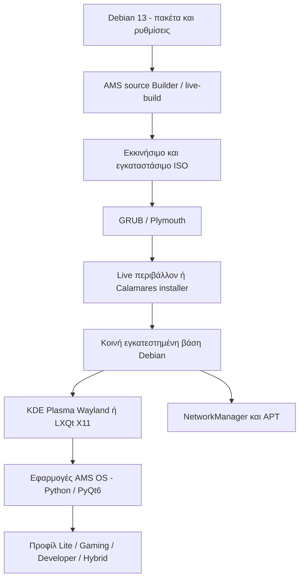

# AMS OS

**Ανεξάρτητο έργο ανάπτυξης λειτουργικού Linux με βάση το Debian 13 (Trixie) | Δοκιμαστική έκδοση ανάπτυξης**

**Γλώσσα τεκμηρίωσης:** [Ελληνικά](README_GR.md) · [English](README.md)

Το AMS OS είναι ένα πειραματικό έργο διανομής Linux, το οποίο αξιοποιεί το Debian 13 ως κοινή βάση. Στόχος είναι ένα σύγχρονο και εύχρηστο περιβάλλον εργασίας, με οπτική ταυτότητα AMS, εφαρμογές διαχείρισης, επιλογές γλώσσας Ελληνικά/Αγγλικά και διαφορετικά προφίλ χρήσης πάνω στον ίδιο βασικό πυρήνα συστήματος.

> **Κατάσταση:** Development preview. Δεν πρόκειται για πιστοποιημένη έκδοση παραγωγής ή για διανομή δοκιμασμένη σε κάθε κατηγορία υλικού. Ορισμένες εικόνες των βίντεο είναι σχεδιαστικές αναπαραστάσεις του UI και όχι αυτούσια στιγμιότυπα από μία πραγματική εγκατάσταση.

## Βίντεο παρουσίασης

https://github.com/user-attachments/assets/77eea885-a86d-4f48-99f9-22d3ca65f810


Το βίντεο δείχνει την εμπειρία εκκίνησης, την οθόνη καλωσορίσματος, τη ρύθμιση πληκτρολογίου, την περίληψη εγκατάστασης, τις εφαρμογές AMS OS, τις ρυθμίσεις συστήματος, τις τέσσερις Editions και το KDE Plasma desktop.

> **Σημείωση για τις εικόνες:** Το προωθητικό υλικό περιέχει σχεδιασμένες αναπαραστάσεις εμπνευσμένες από την ανάπτυξη του project. Δεν αποτελεί συνεχή βιντεοσκόπηση του ίδιου παραγωγικού build ούτε αποδεικνύει ότι κάθε εικονιζόμενη λειτουργία έχει ολοκληρωθεί. Οι σύνδεσμοι του GitHub μπορεί να ανοίγουν ή να κατεβάζουν τα MP4 ανάλογα με τη συσκευή.

## Αρχιτεκτονική



Το AMS OS **δεν** χρησιμοποιεί δικό του Linux kernel ή νέο ανεξάρτητο compositor. Βασίζεται στον πυρήνα, στη διαχείριση πακέτων και στις υποδομές του Debian, τις οποίες συνδυάζει με δική του παραμετροποίηση, γραφικά και εφαρμογές.

## Κύρια τεχνικά υποσυστήματα

| Περιοχή | Υλοποίηση / στόχος | Κατάσταση |
| --- | --- | --- |
| Βάση | Debian 13 Trixie, διαχείριση πακέτων APT | Δημιουργήθηκε και εγκαταστάθηκε πειραματικό build |
| Παραγωγή ISO | Debian `live-build`, overlays ρυθμίσεων και scripts | Δοκιμές πηγαίου κώδικα και πιλοτικά builds |
| Εκκίνηση | GRUB, προσαρμοσμένο Plymouth και AMS Welcome | Έχουν δοκιμαστεί επιλεγμένα builds |
| Εγκαταστάτης | Calamares με AMS branding | Έχει δοκιμαστεί εγκατάσταση· εκκρεμούν ελληνικές μεταφράσεις |
| Desktop | LXQt/X11 και KDE Plasma/Wayland | Δοκιμές σε συγκεκριμένα περιβάλλοντα |
| Εφαρμογές AMS | Native launcher/ρυθμίσεις/πληροφορίες με Python και PyQt6 | Σταδιακή υλοποίηση και βελτίωση |
| Γλώσσες | Ελληνικά και Αγγλικά στις εφαρμογές AMS | Μερική ενοποίηση· ελλείψεις στον Calamares |
| Wi-Fi | NetworkManager, μόνιμα προφίλ σύνδεσης | Η βελτίωση των Wallet prompts επιβεβαιώθηκε σε δοκιμασμένο build |
| Editions | Lite, Gaming, Developer, Hybrid πάνω σε κοινό core | Προφίλ και επιλογές, όχι τέσσερα πλήρη ανεξάρτητα offline ISO |
| Ενέργειες συστήματος | Ενημερώσεις/εγκαταστάσεις πακέτων με επιβεβαίωση | Οι λεπτομέρειες GUI εξαρτώνται από το build |

## Τέσσερις εκδόσεις / προφίλ

- **Lite:** Ελαφρύτερο περιβάλλον καθημερινής χρήσης με LXQt και περιορισμένο πρόσθετο φορτίο. Οι μετρήσεις RAM από συγκεκριμένες VM δεν εγγυώνται ίδια απόδοση σε κάθε PC.
- **Gaming:** Προφίλ προσανατολισμένο στο παιχνίδι. Εργαλεία όπως GameMode, MangoHud, Vulkan και, όπου εγκατασταθούν, Steam/Proton εξαρτώνται από τα διαθέσιμα πακέτα και τη συμβατότητα υλικού/παιχνιδιών. Δεν θεωρούνται όλα προεγκατεστημένα.
- **Developer:** Προφίλ ανάπτυξης με εργαλεία όπως Python, Git, containers και Android command-line εργαλεία, ανάλογα με την εγκατάσταση. Android Studio, CUDA/ROCm, LoRA runtimes και μεγάλα μοντέλα AI δεν περιλαμβάνονται κατ’ ανάγκη στο ISO.
- **Hybrid:** Συνδυάζει επιλεγμένες δυνατότητες Gaming και Developer, ανάλογα με τον διαθέσιμο χώρο και τα εγκατεστημένα πακέτα.

**Σημαντικό:** Στο τρέχον πρωτότυπο, τα επιπλέον πακέτα κάθε Edition δεν βρίσκονται απαραίτητα στο ISO. Η ολοκλήρωση ενός προφίλ μπορεί να απαιτεί σύνδεση στο Διαδίκτυο μετά την εγκατάσταση. Οι καρτέλες των Editions στο βίντεο είναι αναπαράσταση της επιθυμητής εμπειρίας και όχι επιβεβαίωση ότι κάθε προαιρετικό εργαλείο λειτουργεί ήδη.

## Δημιουργία δοκιμαστικού ISO από τον Builder

Χρησιμοποίησε απομονωμένη VM με Debian 13. Οι παρακάτω εντολές αφορούν το **ξεχωριστό source Builder TAR.GZ**, όχι το ZIP τεκμηρίωσης/βίντεο αυτού του repository. Εάν το όνομα ή ο ριζικός φάκελος του αρχείου διαφέρει, προσαρμόζεις τις διαδρομές στο πραγματικό αρχείο.

```bash
sudo apt update
sudo apt install -y live-build debootstrap squashfs-tools xorriso rsync python3

# Στον φάκελο που βρίσκεται το εγκεκριμένο source Builder TAR.GZ:
tar -xzf AMS_Unified_ISO_Builder.tar.gz
cd AMS_Unified_ISO_Builder

# Έλεγχοι πηγαίου κώδικα:
python3 -m unittest discover -s tests -v
python3 scripts/audit_source.py

# Δημιουργία εγκαταστάσιμου ISO:
sudo bash scripts/build-installable.sh
```

Οι ακριβείς απαιτήσεις σε πακέτα και λήψεις δικτύου εξαρτώνται από το συγκεκριμένο Builder. Το αποτέλεσμα συνήθως τοποθετείται στον φάκελο `out/installable-build/`. Πρέπει να ελεγχθούν η πραγματική ονομασία, το SHA-256 και η δυνατότητα εκκίνησης του αρχείου.

**Προσοχή:** Η εγκατάσταση μέσω Calamares μπορεί να αλλάξει ή να διαγράψει διαμερίσματα. Οι πρώτες δοκιμές πρέπει να γίνονται **μόνο σε αναλώσιμο εικονικό δίσκο VM**, όχι στον κύριο υπολογιστή ή σε δίσκο με χρήσιμα δεδομένα.

## Μεθοδολογία δοκιμών και επικύρωσης

1. **Έλεγχος source:** Εκτέλεση των unit tests, ελέγχου source audit και checksums όπου παρέχονται. Η επιτυχία τους δεν πιστοποιεί από μόνη της το τελικό ISO.
2. **Live boot:** Έλεγχος GRUB, Plymouth, AMS Welcome, Try mode και επιλογής γλώσσας σε UEFI/VM.
3. **Εγκατάσταση:** Δοκιμή Calamares αποκλειστικά σε δοκιμαστικό δίσκο· έλεγχος διαμερισμάτων, ρυθμίσεων γλώσσας και πρώτη εκκίνηση από τον εγκατεστημένο δίσκο.
4. **Desktop:** Έλεγχος LXQt/X11 και KDE Plasma/Wayland, taskbar, εικονιδίων, themes και αλλαγής ελληνικών/αγγλικών.
5. **Wi-Fi:** Έλεγχος νέας σύνδεσης, αποθήκευσης διαπιστευτηρίων και επανασύνδεσης μετά από restart, χωρίς μη εξουσιοδοτημένες αλλαγές σε αποθηκευμένους κωδικούς ή πολιτικές ασφάλειας.
6. **AMS GUI:** Δοκιμές Updates, Editions, λεπτομερειών εργασιών, προόδου και μηνυμάτων σφάλματος· ιδιαίτερος έλεγχος αναγνωσιμότητας σε Light/Dark.
7. **Αναπαραγωγιμότητα:** Καταγραφή έκδοσης ISO/Builder, hash, υλικού ή VM, logs (`journalctl`), screenshots και σαφούς αποτελέσματος PASS/FAIL.

Τα πραγματικά αποτελέσματα αφορούν τα συγκεκριμένα builds και μηχανήματα στα οποία έγιναν οι δοκιμές. Δεν επεκτείνονται αυτομάτως σε όλες τις συσκευές.

## Γνωστοί περιορισμοί και επόμενα βήματα

- Πληρέστερη ελληνική μετάφραση του Calamares και έλεγχος λειτουργίας της σε πραγματικό runtime, συμπεριλαμβανομένων των εναπομεινασών αγγλικών επιγραφών.
- Σταθεροποίηση της γραφικής προόδου, των logs και του παραθύρου λεπτομερειών για ενημερώσεις και εγκατάσταση Editions.
- Διατήρηση της δοκιμασμένης συμπεριφοράς Wi-Fi και επανεκκίνησης κατά τις επόμενες οπτικές αλλαγές.
- Περισσότερες δοκιμές σε διαφορετικά UEFI συστήματα, GPUs, Wi-Fi chipsets και υπολογιστές χαμηλής RAM.
- Επαλήθευση εγκατάστασης και πραγματικής λειτουργίας των προαιρετικών πακέτων σε κάθε Edition.
- Διερεύνηση πλήρως offline installer με επιλογή Edition ως **μελλοντικό στόχο**, όχι ως ήδη ολοκληρωμένη λειτουργία.

## Δημοσίευση, άδεια και ονομασία

Η ονομασία **AMS OS** χρησιμοποιείται προσωρινά μέχρι να ολοκληρωθεί ο νομικός έλεγχος εμπορικού σήματος. Το README αυτό δεν δηλώνει ότι έχει επιλεγεί άδεια ανοιχτού κώδικα. Πριν από δημόσια διάθεση του source απαιτείται κατάλληλη άδεια, έλεγχος δικαιωμάτων και διατήρηση των υποχρεώσεων από Debian, KDE, LXQt, Calamares και άλλες upstream άδειες.

Το παρόν ZIP περιέχει **μόνο τεκμηρίωση και αρχεία παρουσίασης**, όχι τον πηγαίο Builder ούτε πλήρες ISO. Οι οδηγοί build έχουν νόημα μόνο εφόσον υπάρχει το αντίστοιχο source TAR.GZ.

---

*AMS OS — Τέσσερις κατευθύνσεις, μία κοινή βάση Linux. Έργο υπό ανάπτυξη.*
